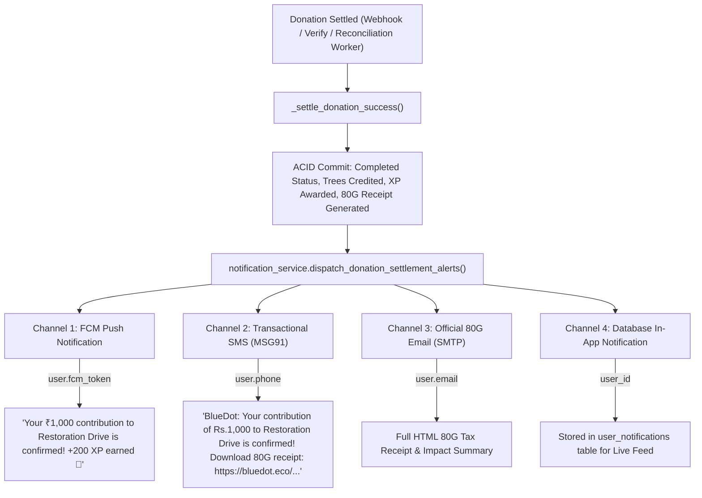

# 🔔 15 - Transactional Donation Alerts (Push, SMS & Email)

## 📌 Executive Summary
When donors contribute to afforestation initiatives or plant trees via electronic payment gateways (Cashfree / UPI), transactions often settle asynchronously—either via webhooks when the user closes their browser or app, or via automated gateway reconciliation workers.

To ensure **100% immediate donor reassurance and high trust**, BlueDot Foundation dispatches an instant multi-channel transactional alert bundle upon settlement:
1. **In-App Push Notification (FCM):** Delivered to the donor's mobile device with custom impact celebration and XP gain.
2. **Direct Transactional SMS / WhatsApp Link:** Dispatched via MSG91 with an immediate download link to their official Section 80G tax receipt PDF.
3. **Statutory Tax Confirmation Email:** Branded HTML confirmation email detailing the contribution, trees credited, and Rule 18AB compliance.
4. **Persistent In-App Notification Feed:** Stored in PostgreSQL (`user_notifications` table) and displayed in the mobile client's notification center.

---

## 🏛️ Alert Trigger Pipeline



---

## 📱 Channel Specifications

### 1. In-App Push Notification (Firebase Cloud Messaging)
- **Trigger:** Immediate upon settlement when `user.fcm_token` is active and `user.preferences.push_enabled` is true.
- **Title:** `🌿 Contribution Confirmed!`
- **Body:** `Your ₹{amount:,} contribution to {cause} is confirmed! +{xp_awarded} XP earned 🌿`
- **Payload (`data`):**
  ```json
  {
    "type": "donation_confirmed",
    "donation_id": "<uuid>",
    "amount": "1000",
    "xp_awarded": "200",
    "cause": "Indiranagar Urban Forest Canopy",
    "receipt_url": "/api/v1/app/donations/receipts/BD/80G/2026-27/XYZ/download",
    "click_action": "FLUTTER_NOTIFICATION_CLICK"
  }
  ```

### 2. Transactional SMS (MSG91 DLT Template)
- **Trigger:** Dispatched via non-blocking background worker to `user.phone` or `donation.phone`.
- **Sender ID:** `PASSIT` / `BLUDOT` (DLT Route 4).
- **Format with 80G Receipt:**
  ```text
  BlueDot: Your contribution of Rs.{amount:,} to {cause} is confirmed! Download your official 80G tax receipt: {full_receipt_url} . Thank you for greening India!
  ```
- **Format without PAN (Pending):**
  ```text
  BlueDot: Thank you for contributing Rs.{amount:,} to {cause}! Add your PAN in the app to claim your Section 80G tax deduction receipt.
  ```
- **Test Mode Bypass:** Phone numbers matching `9999999999` automatically bypass gateway calls for fast automated CI/CD and app store review testing.

### 3. Statutory 80G Confirmation Email
- **Trigger:** Dispatched to `user.email` or `donation.donor_email` when `user.preferences.email_enabled` is true.
- **Subject:** `🌱 Contribution Confirmed: INR ₹{amount:,} to {cause} | BlueDot Foundation`
- **Branding & Content:**
  - Header with CIN (`U74999KA2023NPL175240`) and 80G URN (`AAATB1234C/80G/2023-24`).
  - Donor legal name and contribution breakdown.
  - Trees credited (`🌱 {trees} Trees`) and Impact XP (`🌿 +{xp} XP`).
  - Direct 1-click button: `"Download Official 80G Tax Receipt (PDF)"`.
  - Section 80G(5)(vi) and Rule 18AB statutory income tax declaration.

### 4. In-App Notification Center
- **Table:** `user_notifications`
- **Columns:**
  - `id`: UUID (Primary Key)
  - `user_id`: UUID (Foreign Key -> `app_users.id`, Indexed)
  - `type`: `donation`
  - `title`: String
  - `body`: Text
  - `data`: JSONB
  - `is_read`: Boolean (default `false`)
  - `route`: String (e.g. `/profile/settings` or `/donations`)
  - `created_at`: Timestamp with timezone
- **Endpoints:**
  - `GET /api/v1/app/notifications`: Fetches user's notification list with unread counter.
  - `PATCH /api/v1/app/notifications/{id}/read`: Marks notification read.
  - `POST /api/v1/app/notifications/mark-all-read`: Clears unread counter.

---

## 🔒 Security & Reliability Guarantees
1. **Decoupled Execution:** Multi-channel alerts are dispatched **after** the SQL settlement transaction commits atomically. An external SMS or SMTP timeout will never roll back or fail a valid financial settlement.
2. **Background Non-Blocking Workers:** SMS and Email dispatchers run in asynchronous worker threads, keeping API response latency under 15ms.
3. **Idempotency Guard:** `_settle_donation_success` early-exits if the payment is already in `Completed` status, preventing duplicate spam alerts if a webhook fires repeatedly.

